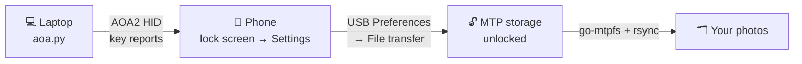
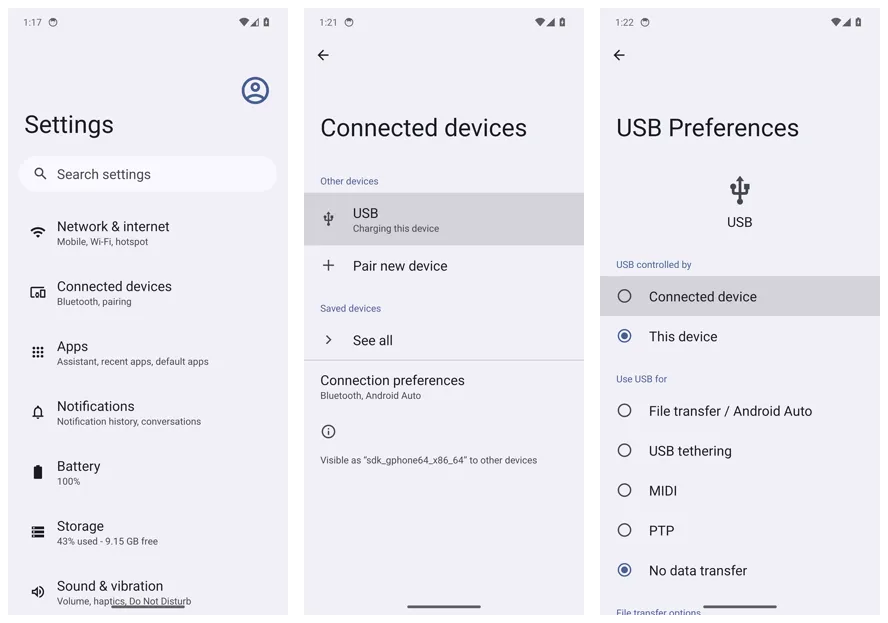
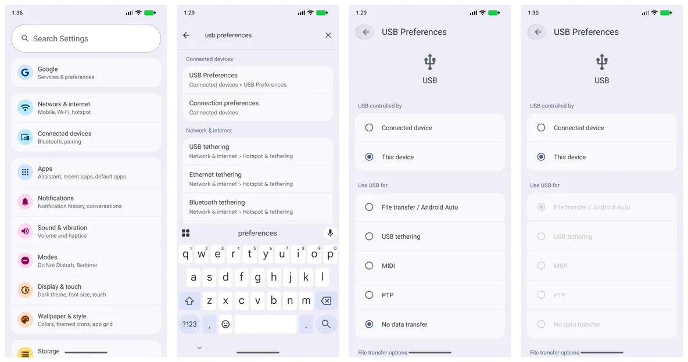
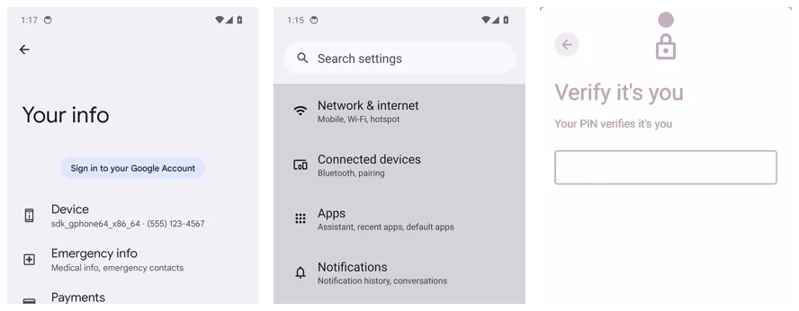
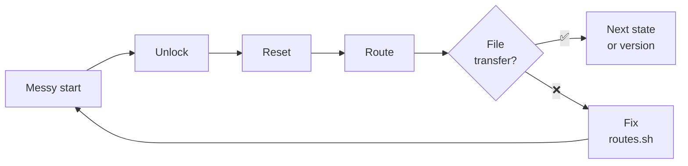

<div align="center">

# blind-android-rescue

**Get your photos off an Android phone with a dead screen.**<br>
No opening it up, no ADB, no display: the laptop pretends to be a USB keyboard and types its way to
*File transfer*.

[](LICENSE)


</div>

---

Built to rescue the photos from a Pixel 7 Pro with a black display, touch in unknown shape, USB debugging off
and nothing in the cloud. The phone's screen stayed black the whole time, and the first real run unlocked its
storage.



## Contents

- [Does this fit your phone?](#does-this-fit-your-phone)
- [Before you run it](#before-you-run-it)
- [Quick start](#quick-start)
- [The routes](#the-routes)
- [How it works](#how-it-works)
- [Training a new route](#training-a-new-route)
- [Repository layout](#repository-layout)

## Does this fit your phone?

| | Requirement |
|---|---|
| ✅ | The phone still **boots**: it shows up in `lsusb`, vibrates, rings. |
| ✅ | The **USB-C port** works. |
| ✅ | You **know the PIN/password**. Nothing here bypasses the lock screen. |
| ✅ | It's **Android**. iPhones don't support AOA. |
| ⚠️ | There's a **route for its Settings layout**. Trained: Pixel on Android 14, 15, 16. Other makers need their own route, see [Training a new route](#training-a-new-route). |

> [!TIP]
> If USB debugging was already on, you don't need this: use `adb pull` or `scrcpy`.

## Before you run it

> [!WARNING]
> **Wrong PIN attempts count.** Several failures lock the phone for increasing periods. Run one route at a
> time and check the result before trying the next.

> [!CAUTION]
> **Keys go wherever focus is.** On an untrained version or in an unexpected state, Tab and Enter click
> things you can't see. The routes start with a reset, but a wrong route can still open or toggle things in
> Settings.

> [!NOTE]
> **Fingerprint prompts.** Newer Android versions ask "Verify it's you" before switching to File transfer.
> With a fingerprint enrolled that prompt may default to the sensor, which under a dead display can't work.
> A keyboard path to "Use PIN" isn't trained yet.

## Quick start

Needs Linux, [uv](https://docs.astral.sh/uv/) (the scripts carry their own `pyusb` dependency) and USB access
to the phone (root, or a udev rule for its vendor ID).

**1. Check the phone and its USB mode**

```bash
cd phone
pkill -x kiod6                    # KDE only: kiod6 grabs the MTP interface
uv run --script ptpcheck.py       # GetStorageIDs 0x2001 00000000  →  locked ("No data transfer")
```

**2. Type the route** (replace `1234` with your PIN)

```bash
. ../routes.sh
uv run --script aoa.py $(unlock 1234) $RESET $(route_c 1234)    # Android 14 / 15
uv run --script aoa.py $(unlock 1234) $RESET $(route_s 1234)    # Android 16
```

Or let `./rescue.sh 1234` try `route_s`, then `route_c`, checking after each.

**3. Check again**

```bash
sleep 5; uv run --script ptpcheck.py    # anything but 00000000  →  storage unlocked 🎉
```

When the mode switches, the phone reconnects on USB, so `aoa.py` ending with `No such device` is the
**success** case.

**4. Copy your files**, for example with [go-mtpfs](https://github.com/hanwen/go-mtpfs):

```bash
mkdir -p ~/phone && go-mtpfs ~/phone &
rsync -rt ~/phone/"Internal shared storage"/{DCIM,Pictures} ~/rescued/
rsync -rt ~/phone/"Internal shared storage"/Android/media/com.whatsapp ~/rescued/   # messenger media
fusermount -u ~/phone
```

File transfer stays on until you unplug the cable. Not a Google phone? Set `VID` to its USB vendor ID, for
example `VID=04e8` for Samsung (see `lsusb`).

## The routes

Every run starts the same way:

| Phase | Keys | Why |
|---|---|---|
| **unlock** | <kbd>Shift</kbd> · <kbd>Menu</kbd> · <kbd>⌫</kbd>×6 · *PIN* · <kbd>Enter</kbd> | <kbd>Menu</kbd> opens the PIN pad whatever the lock screen has focused. <kbd>Space</kbd> would "click" a leftover focus instead, e.g. the date, which then opens Calendar. The Backspaces stop a digit getting lost while the pad animates in. |
| **reset** | <kbd>Back</kbd>×6 · <kbd>Meta</kbd>+<kbd>Tab</kbd> · <kbd>Del</kbd>×10 | Opens Overview and dismisses every task, so the next Settings starts fresh with no focus and no remembered subpage. |

### `route_c`: Android 14 / 15, via Connected devices

<kbd>Meta</kbd>+<kbd>I</kbd> → <kbd>Tab</kbd>×3 → <kbd>Enter</kbd> → <kbd>Enter</kbd> → <kbd>Tab</kbd>×2 → <kbd>Enter</kbd> → *PIN* <kbd>Enter</kbd>



<sub>Settings home, where the third Tab is Connected devices · "USB" is focused on arrival · USB Preferences: Connected device → This device → File transfer</sub>

### `route_s`: Android 16, via Settings search

<kbd>Meta</kbd>+<kbd>I</kbd> → <kbd>Tab</kbd> → <kbd>Enter</kbd> → `usb` <kbd>Shift</kbd>+<kbd>Space</kbd> `preferences` → <kbd>↓</kbd> → <kbd>Enter</kbd> → <kbd>Tab</kbd>×3 → <kbd>Enter</kbd> → *PIN* <kbd>Enter</kbd>



<sub>Tab lands on Search Settings · "USB Preferences" is hit #1 · focus starts on Navigate up, so Tab×3 = File transfer · selected (grey only because the emulator has no real USB)</sub>

### What differs between versions

| | Android 14 | Android 15 | Android 16 (QPR2) |
|---|:---:|:---:|:---:|
| First <kbd>Tab</kbd> in Settings | whole list | whole list | search bar |
| Search reachable by keyboard | ❌ | ❌ | ✅ |
| Focus on arrival in USB Preferences | Connected device | Connected device | Navigate up |
| <kbd>Tab</kbd>s to File transfer | 2 | 2 | 3 |
| "Verify it's you" | no | no | PIN |
| Route | `route_c` | `route_c` | `route_s` |

`route_a17` is an Android 17 route that worked once on a Pixel 8 Pro. It isn't emulator-trained.

### Traps we fell into so you don't have to



- **The avatar trap.** On Android 14/15, <kbd>↑</kbd> or <kbd>Shift</kbd>+<kbd>Tab</kbd> from the Settings list lands on
  the account avatar (Google "Your info"), never on the search bar.
- **Arrows scroll, Tab moves.** On the Settings home page, arrow keys highlight and scroll the whole list as one
  block. Only <kbd>Tab</kbd> steps between entries.
- **"usb" means tethering.** Searching just `usb` ranks *USB tethering* first.
- **A space that scrolls.** On Android 14/15, a plain <kbd>Space</kbd> page-scrolls the list, and the following keys
  wander into the gesture tutorial. <kbd>Shift</kbd>+<kbd>Space</kbd> types a space on Android 16 and does nothing on 14/15.
- **"Verify it's you"** (Android 16) only shows on emulator-level captures, because it's a secure window.
- **You can't read the version over USB.** MTP reports device version `1.0`. So: run one route, check, then the next.
  `route_s` on 14/15 ends harmlessly in Apps; `route_c` on 16 opens Google settings.

## How it works

[Android Open Accessory 2](https://source.android.com/docs/core/interaction/accessories/aoa2) lets a USB host
register HID devices on the phone with plain control requests (`REGISTER_HID`, `SET_HID_REPORT_DESC`,
`SEND_HID_EVENT`). This needs no app, no ADB and no pairing, and it works on the lock screen. `phone/aoa.py`
registers a standard keyboard and plays steps:

| Step | Meaning |
|---|---|
| `wake` | <kbd>Shift</kbd> press |
| `key:<hid>[:<mod>]` | HID usage, optional modifier byte: `01` Ctrl · `02` Shift · `04` Alt · `08` Meta |
| `type:<text>` | Letters, digits, space, `-`, `.`; `_` is typed as a space |
| `enter` · `tab` · `tab:shift` · `esc` | Shortcuts |
| `hold:<secs>:<hid>…` | Hold keys |
| `sleep:<secs>` | Pause |

<details>
<summary>Useful HID usages</summary>

| Key | Usage | | Key | Usage |
|---|---|---|---|---|
| <kbd>Enter</kbd> | `0x28` | | <kbd>↓</kbd> / <kbd>↑</kbd> | `0x51` / `0x52` |
| <kbd>⌫</kbd> (Android DEL) | `0x2a` | | <kbd>Menu</kbd> | `0x76` |
| <kbd>Tab</kbd> | `0x2b` | | <kbd>Back</kbd> | `0xf1` |
| <kbd>Space</kbd> | `0x2c` | | <kbd>Meta</kbd>+<kbd>I</kbd> (Settings) | `0x0c:08` |
| <kbd>Print</kbd> (screenshot) | `0x46` | | <kbd>Meta</kbd>+<kbd>Tab</kbd> (Overview) | `0x2b:08` |

</details>

The success signal is MTP: in "No data transfer" the phone still answers PTP, but `GetStorageIDs` comes back
empty.

The idea is close to [scrcpy's OTG mode](https://github.com/Genymobile/scrcpy/blob/master/doc/otg.md), which
also uses AOA HID without ADB. The difference is that you don't steer a mouse blindly: the routes are fixed key
sequences, rehearsed per Android version.

## Training a new route

Routes are found on Android emulators, where you can ask which element has keyboard focus after every key.



A route for one version must also not do damage on the others: you won't know which version the broken
phone runs.

<details>
<summary><b>Faking USB on an emulator</b></summary>

Emulators have no USB port, so Settings never shows a USB entry. `emulator/` fakes both the hardware and the
connected PC (root image needed):

1. **`efeature.sh`** declares `android.hardware.usb.accessory` / `usb.host` by bind-mounting a permissions XML
   over `/system/etc/permissions` and restarting the framework. It doesn't survive a reboot.
2. **`efakeusb.sh`** simulates a type-C port in device role (`dumpsys usb add-port` / `connect-port`) and sends
   a *sticky* `USB_STATE` broadcast (connected, data locked). `am broadcast` can't do sticky, so
   `sticky/Sticky.java` calls the hidden `IActivityManager` API through `app_process`. It's built by
   `sticky/build.sh`, which needs a JDK and the SDK's `d8`.

</details>

<details>
<summary><b>Emulator setup</b></summary>

Root-capable `google_apis` images, Pixel profile, hardware keyboard:

```bash
A=$HOME/Android/Sdk/cmdline-tools/latest/bin
$A/sdkmanager "system-images;android-35;google_apis;x86_64"
# newer SDKs: $A/android sdk install system-images/android-35/google_apis/x86_64
echo no | $A/avdmanager create avd -n p7r_35 -k "system-images;android-35;google_apis;x86_64" -d pixel_7_pro
sed -i 's/^hw.keyboard=.*/hw.keyboard=yes/' ~/.android/avd/p7r_35.avd/config.ini
emulator/eboot.sh p7r_35     # boots on 5554, roots, fakes USB, sets PIN $EPIN (default 1234)
emulator/eroute.sh route_c   # unlock + reset + route, prints the checked USB option
```

Run one emulator at a time: three at once can exhaust 30 GB of RAM. The Android 16 image crashed on
`KEYCODE_SLEEP`.

</details>

<details>
<summary><b>Emulator tools</b></summary>

| Script | Purpose |
|---|---|
| `emu.py STEPS…` | Same steps as `aoa.py`, sent via `adb shell input keyboard` |
| `efocus.sh` | Resumed activity and focused UI node, the main training tool |
| `es.sh OUT STEPS…` | Steps + screenshot + focus |
| `elook.sh OUT STEPS…` | Same, captured at emulator level, so secure windows like PIN prompts show too |
| `emess.sh N` | Messy start: 1 Settings subpage · 2 deep page with focus · 3 launcher with search text · 4 scrolled + screen off |
| `eroute.sh route…` | Per route: reset Settings and USB, run it, print the checked USB option |
| `etap.sh REGEX` | Tap a node by text (setup only) |

</details>

## Repository layout

```
routes.sh          shared step lists: unlock, RESET, route_s, route_c, route_a17
phone/
  aoa.py           AOA2 HID keyboard, plays steps
  rescue.sh        unlock, then route by route until the storage unlocks
  ptpcheck.py      PTP GetStorageIDs: the success check
  devinfo.py       MTP DeviceInfo (works in "No data transfer" too)
  shot.py look.sh  once unlocked: press Print, fetch the screenshot. Now you can see the screen
  mtpreset.py      PTP Device Reset for a hung MTP responder
emulator/          training rig (see above)
```

## License

[MIT](LICENSE). Use at your own risk: a wrong route on a real phone clicks things you can't see.
